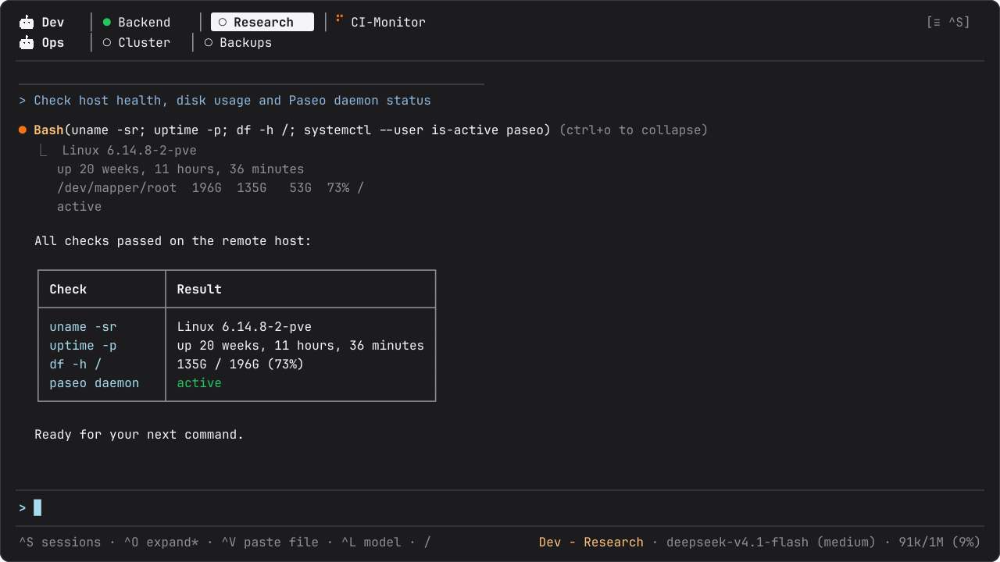

# hermes-tui (`htui`)

A real, modern terminal UI (React + Ink) built to replace **Hermes Agent**'s default TUI — with native **remote control** over SSH powered by the **Paseo** daemon.

> Run your Hermes agents continuously on a remote server (or locally) via Paseo, and control every session from a fast, multi-tab terminal interface synchronized in real time with Paseo Desktop & Mobile.



---

## Why `hermes-tui`?

> **What was missing wasn't just another TUI** — there are plenty of terminal chat clients out there. What was missing was a TUI built on top of **persistent agents**, with **multiple distinct roles visible at a glance**, their **live state**, and **remote control** across devices.
>
> Instead of reinventing the agent runtime or the sync layer, `hermes-tui` relies on a proven core (**Hermes** for agent execution, tools & memory; **Paseo** for multi-device session orchestration) and focuses purely on being the fastest, sharpest terminal view on top.

- **A real TUI replacement for Hermes:** clean, `agy` / `opencode`-inspired layout with theme-adaptive terminal colors, Unicode Markdown tables, framed code blocks, wrapped lists, and zero text clipping.
- **Multi-role persistent agents at a glance:** view all your specialized agents (e.g., *Execution*, *Planning/Gatekeeper*, *Security/Watch*) and their topic sessions in a pinned multi-row header, with live status badges (`working`, `done/unread`, `idle`) and instant inter-agent message forwarding (`/to <session>`).
- **Native Remote Control via Paseo:** your agents stay alive on your server under the Paseo daemon (`~/.paseo`). Connect from any workstation over SSH with automatic reconnect after sleep or network drops, and stay 100% synchronized in real time with Paseo Desktop & Mobile (workspaces, titles, unread badges, and archives stay aligned across every device).
- **Multi-session tab bar at the top:** sessions grouped by agent, clickable directly with the mouse, with live status badges:
  - `⠋` **orange**: running (*working*)
  - `●` **green**: turn finished (*terminé*)
  - `○` **dim**: waiting (*idle*)
- **Clean collapsible tool calls (`Ctrl+O`) & live `Thinking…` indicator:** consecutive tool invocations (`Bash`, `Edit`, `Read`, `Memory`, etc.) are grouped and collapsed by default (`● Bash(…) (ctrl+o to expand)`), expand cleanly with single-`⎿` indentation and colorized `Edit` diffs (`+`/`-`), and reasoning shows a minimal live `Thinking…` indicator.
- **Modern terminal ergonomics:**
  - Full prompt editing (`←`/`→`, `Home`/`End`, `Ctrl+E`, `Ctrl+W`, `Ctrl+U`, `Ctrl+K`, and multi-line input via `Shift+Enter` / `Alt+Enter`) with **per-session drafts** preserved when switching tabs and **smart `[Pasted #N +M lines]` tokens** (deleted & navigated atomically).
  - **One-click code copy:** single-click any line of code (fenced block row or inline `` `code` ``) to copy that logical line, or click the code block header (`╭─ lang ─── copier ─╮`) to copy the entire code block.
  - Quick copy via **`Ctrl+Y`** or **`/copy [code]`** to copy the latest code block or full assistant reply.
  - Instant **in-session search** (`Ctrl+F`) with match highlighting and auto-jump.
  - Mouse drag selection with **auto-copy on release** (`wl-copy` + `OSC 52`).
  - Mouse wheel and `PgUp`/`PgDn` scrolling with **automatic scroll lock** while reading history during live streaming.
  - Subtle **`HH:MM` turn timestamps** and **responsive Markdown tables** that wrap cells cleanly to fit the terminal width.
  - **Local state persistence** (`~/.cache/hermes-tui/state.json`) remembering your last active session tab, prompt history (`↑`/`↓`), and `Ctrl+O` expansion state across restarts.
  - Clipboard **image, PDF, and file attachments** via `Ctrl+V` (or pasted path / `file://` URI).
  - Live **context window usage** (`used/max (%)`) in the bottom status bar.
  - Desktop notifications (`notify-send`, disable via `HERMES_TUI_NOTIFY=0`) when background agents finish or request permission.
  - Client-side **`NO_REPLY` / `[SILENT]` filter** to keep conversations noise-free.
  - Interactive pickers for **models/providers** (`Ctrl+L`), **thinking level** (`Ctrl+T`), **approval mode** (`/mode`), and **sessions** (`Ctrl+S` / `Ctrl+A`), backed by a stale-while-revalidate timeline cache.
  - Create (`/new [title]`), rename (`/title <name>`), reset (`/reset`), and archive (`/archive`) sessions directly from the TUI.

---

## Architecture

```
[ Workstation: hermes-tui (htui) ]
        │  NDJSON over stdin/stdout (local or SSH BatchMode)
        ▼
[ Host: bridge/hermes-paseo-bridge.mjs ]
        │  @getpaseo/cli client (connectToDaemon)
        ▼
[ Paseo Daemon (~/.paseo) ] ──► [ Hermes ACP Agents ]
```

- `bin/htui.mjs` — CLI entrypoint (`htui` / `hermes-tui`).
- `src/index.tsx` — React + Ink TUI, SGR mouse & drag-selection handling, clipboard attachments, modals.
- `src/markdown.tsx` — Terminal Markdown renderer (tables, fenced code blocks, headings, lists, links, ANSI-aware wrapping).
- `src/types.ts` — Shared TypeScript types.
- `bridge/hermes-paseo-bridge.mjs` — Lightweight NDJSON bridge talking to the Paseo daemon.

---

## Installation

### Local (same machine as Paseo)

```bash
git clone git@github.com:Adjenz/hermes-tui.git
cd hermes-tui
npm install
npm link        # exposes `htui` and `hermes-tui` globally
htui --check
```

### Remote Control (SSH to a Paseo + Hermes server)

1. **On your workstation:**
   ```bash
   git clone git@github.com:Adjenz/hermes-tui.git
   cd hermes-tui
   npm install
   npm link
   ```
2. **On your server (where Paseo + Hermes run):**
   ```bash
   scp bridge/hermes-paseo-bridge.mjs user@your-server:~/.local/bin/hermes-paseo-bridge.mjs
   ```
3. **Configure the target host** (e.g. in `~/.bashrc` / `~/.zshrc` or a wrapper):
   ```bash
   export HERMES_TUI_HOST="user@your-server"
   htui --check
   ```

### Requirements

- **Client:** Node.js ≥ 18; on Linux/Wayland, `wl-clipboard` (`wl-paste` / `wl-copy`) for `Ctrl+V` file/image attachments and clipboard copy (`OSC 52` is also emitted as fallback).
- **Host running Paseo:** Node.js, `@getpaseo/cli` (tested against `0.15.x` – `0.16.x`; pin your `@getpaseo/cli` version on the server to avoid unexpected internal client changes), and the Paseo daemon running (`~/.paseo`).
- **Healthcheck / Contract verification:** `htui --check` verifies both SSH/daemon connectivity and the `@getpaseo/cli` client method contract (`contract.ok`), making it suitable for a daily cron healthcheck after server updates.

---

## Configuration

| Environment Variable | Description | Default |
|---|---|---|
| `HERMES_TUI_HOST` | SSH target (`user@host`). If unset/empty, runs the bridge locally. | *(empty = local)* |
| `HERMES_TUI_BRIDGE_PATH` | Path to `hermes-paseo-bridge.mjs` on the target host. | `~/.local/bin/hermes-paseo-bridge.mjs` (SSH) or local |
| `PASEO_HOME` | Paseo daemon home directory on the host. | `~/.paseo` |
| `PASEO_CLIENT_PATH` | Explicit path to `@getpaseo/cli/dist/utils/client.js`. | Auto-detected (common paths + `npm root -g`) |

---

## Usage & Shortcuts

```bash
htui              # Launch the TUI
htui my-agent     # Jump directly to a session by name or ID prefix
htui --check      # Test connection to the Paseo bridge
htui --help       # Show CLI help
```

| Shortcut | Action |
|---|---|
| Click a tab (top bar) | Switch to that session |
| Single-click a code line / header | Copy that logical line of code (or the whole block when clicking `╭─ … copier ─╮`) |
| Mouse drag in chat | Select text & auto-copy on release |
| Mouse wheel / `PgUp` / `PgDn` | Scroll conversation history (locks position while streaming) |
| `Ctrl+Y` / `/copy [code]` | Copy latest code block or latest assistant response |
| `Ctrl+O` | Expand / collapse tool call details |
| `Ctrl+F` | Search in current conversation (`Enter` / `↑↓` to jump, `Esc` to close) |
| `Ctrl+V` | Attach clipboard image / PDF / file (or paste text) |
| `Ctrl+S` / `Ctrl+A` / `/sessions` | Open full session picker with search & badges |
| `Ctrl+N` / `Ctrl+P` | Next / previous session |
| `Ctrl+L` / `/model` | Switch LLM model / provider |
| `Ctrl+T` / `/thinking` | Change thinking level |
| `/mode` | Change approval mode (`default`, `accept_edits`, `dont_ask`) |
| `/to <session> [text]` | Forward the latest assistant response to another session |
| `/help` | List every available slash command (hermes-tui + Hermes) |
| `/shortcuts` | List every keyboard and mouse shortcut |
| `/new [title]` | Create a new Hermes session |
| `/title <name>` | Rename the current session tab in Paseo |
| `/reset` | Recreate a fresh session with the same name & archive the old one |
| `/archive` | Archive the current session |
| `←`/`→`, `Home`/`End`, `Ctrl+W`/`U`/`K` | Move cursor & edit prompt |
| `Shift+Enter` / `Alt+Enter` | Insert a newline in the prompt |
| `/` + `Tab` | Slash-command autocomplete |
| `Esc` | Cancel active turn or close modal |
| `Ctrl+C` | Quit |

---

## Contributors

- **Adjenz** — Creator & maintainer
- **Gemini** — Architecture, UI/UX, and implementation
- **Claude** — Performance optimization, features, and polish

---

## License

[MIT](LICENSE) © Adjenz
